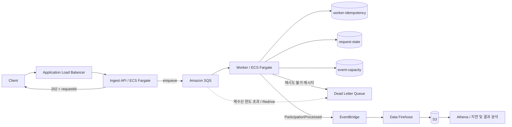

# Async Distributed System

### 트래픽 급증을 큐로 흡수하고, 접수와 처리를 독립적으로 확장하는 비동기 이벤트 처리 시스템

선착순·응모 이벤트에 요청이 몰리는 상황을 대상으로 **Spring Boot + Amazon SQS + DynamoDB 기반 백엔드**를 구현했습니다. 요청 접수는 Ingest API가, 실제 처리와 상태 관리는 Worker가 담당합니다. 처리 이벤트를 분석해 병목을 찾고, 부하 테스트 결과를 바탕으로 접수 계층의 DB 의존성을 제거하는 방향으로 구조를 개선했습니다.
  
> 구현 설명은 위 저장소의 `main` 브랜치 개선 코드 기준입니다. 부하 테스트 결과는 각 실험 당시의 구성에서 측정한 값이며, 개선 코드 전체의 성능 보증을 의미하지 않습니다.

  
  
## 1. 해결하려는 문제

이벤트 오픈 시점에 요청이 집중되면 접수 API와 실제 처리 로직이 함께 포화될 수 있습니다. 여러 Worker가 동시에 동작하면 중복 요청과 메시지 재전달, 정원 차감 경쟁도 함께 고려해야 합니다.

이 프로젝트에서는 다음 세 가지를 중심으로 백엔드를 설계했습니다.

- **접수와 처리 분리:** SQS 적재 성공 후 `202 Accepted + requestId`를 반환하고, 처리는 Worker에서 진행합니다.
- **중복·동시성 제어:** DynamoDB 조건부 쓰기로 이벤트별 사용자 중복과 요청 상태 전이를 제어합니다.
- **병목의 정량화:** API 응답 시간, 큐 대기 시간, Worker 처리 시간을 분리해 확장과 개선의 근거로 사용합니다.

`202 Accepted`는 큐 적재 성공을 뜻합니다. 선착순 참여 성공이나 당첨을 의미하지 않으며, SQS 전송에 실패하면 오류를 반환합니다.


  
## 2. 시스템 아키텍처



  
| 구성 요소 | 역할 |
| --- | --- |
| Ingest API | 요청 수신, requestId 생성, 메시지 직렬화 및 SQS 적재 |
| SQS | 유입 속도와 처리 속도의 차이를 흡수하고 메시지 재전달 지원 |
| Worker | 멱등성 검사, 상태 생성·전이, 정원 차감, 실패 분류 및 처리 이벤트 발행 |
| DynamoDB | 요청 상태·중복 참여 키·이벤트 잔여 정원 저장 |
| EventBridge → Firehose → S3 → Athena | 처리 이벤트 적재 및 SQL 기반 사후 분석 |
| CloudWatch | ALB 응답 지연, 큐 적체, 태스크 수, 오류 로그 관측 |

Ingest와 Worker를 별도 ECS 서비스로 구성해 접수 용량과 소비 용량을 각각 조절합니다. 분석 파이프라인은 개발 문서에 기록된 AWS 구성이고, 저장소에는 Worker의 EventBridge 발행 코드가 포함되어 있습니다.


  
## 3. 기술 스택 및 프로젝트 구성

| 구분 | 기술 |
| --- | --- |
| Language / Framework | Java 21, Spring Boot 4.0.1 |
| Build | Gradle 멀티 모듈 |
| Queue / Database | Amazon SQS, DynamoDB, AWS SDK for Java v2 |
| Runtime / Deployment | ECS Fargate, ALB, Docker, ECR, GitHub Actions |
| Analytics / Observability | EventBridge, Data Firehose, S3, Athena, CloudWatch, Micrometer |
| Load Test | k6 |

```text
.
├── ingest-api/        # 요청 접수 및 SQS 적재
├── worker/            # 메시지 소비, 상태 관리, 정원 차감, DLQ 및 이벤트 발행
├── common/            # 메시지 계약, 도메인 모델, 상태·결과 코드
├── admin-api/         # 이벤트 관리 및 추첨 관련 코드
├── frontend/          # 사용자·관리자 화면
├── k6/                # 단계별 부하 테스트 스크립트
├── docs/              # 기획, 아키텍처, 초기 부하 테스트 보고서
└── .github/workflows/ # Ingest·Worker ECS 배포
```

현재 개선 흐름의 Worker는 `request-state(requestId)`, `worker-idempotency(idempotencyKey)`, `event-capacity(eventId)` 세 테이블을 사용합니다. 초기 단일 테이블·GSI 기반 설계와 관리자 코드가 함께 남아 있어, 모듈별 데이터 구조의 일치 여부는 추가 정리 대상입니다.


  
## 4. 백엔드 핵심 구현
  
### 4.1. Ingest를 SQS 적재에 집중하도록 개선

초기 Ingest는 멱등성 검사, 요청 상태 생성, 상태 전이 등 여러 DynamoDB 작업을 수행한 뒤 SQS에 메시지를 전송했습니다. 접수 응답이 DB 호출과 정합성 처리 시간에 영향을 받는 구조였습니다.

개선 과정에서 해당 책임을 Worker로 옮겼습니다.

```text
초기: 요청 → 멱등성 검사 → DB 상태 생성·전이 → SQS → 202
개선: 요청 → requestId 생성 → SQS → 202
```

접수 경로의 DB I/O를 제거하면서, 중복 요청도 큐에 들어올 수 있게 했습니다. 그 대신 처리 직전의 중복 판정과 상태 관리를 Worker가 담당하도록 경계를 조정했습니다. 다만 SQS 전송 자체는 동기 네트워크 호출이므로, 연결 풀과 전송 지연은 여전히 접수 성능에 영향을 줍니다.

근거: [ParticipationService](https://github.com/Dianaland1112/Async-Distributed-System/blob/main/ingest-api/src/main/java/com/teamA/async/ingest/service/ParticipationService.java) 

  
### 4.2. Worker의 멱등성 처리와 조건부 상태 전이

SQS 메시지의 중복 수신과 여러 Worker의 동시 처리를 전제로 두 단계의 조건부 쓰기를 적용했습니다.

| 단계 | 기준 | 처리 방식 |
| --- | --- | --- |
| 이벤트별 사용자 중복 제어 | `IDEMP#{eventId}#{userId}` | 최초 요청의 requestId를 기록하고, 다른 requestId의 중복 참여는 건너뜀 |
| 요청별 처리권 선점 | `requestId`와 현재 상태 | `QUEUED`일 때만 `PROCESSING`으로 조건부 전이 |

멱등성 키는 **같은 requestId의 재시도는 허용**하도록 구성했습니다. 새 요청의 중복 참여와 기존 메시지의 재처리 시도를 구분하기 위한 조건입니다.

```text
RECEIVED → QUEUED → PROCESSING → SUCCEEDED
                             → REJECTED
                             → FAILED_FINAL

일시적 오류: 해당 처리 시도의 PROCESSING → QUEUED 복귀 시도 → 재전달
```

재시도 시 상태를 되돌릴 때는 `status = PROCESSING`과 `startedAt`을 함께 검사해 해당 처리 시도에 대해서만 갱신하도록 했습니다. 이 구현의 범위는 중복 진입 및 상태 경합 제어이며, 모든 장애 시점의 부수 효과까지 원자적으로 보장하는 구조는 아닙니다.

근거: [WorkerIdempotencyRepository](https://github.com/Dianaland1112/Async-Distributed-System/blob/main/worker/src/main/java/com/teamA/async/worker/ddb/WorkerIdempotencyRepository.java) · [RequestStateRepository](https://github.com/Dianaland1112/Async-Distributed-System/blob/main/worker/src/main/java/com/teamA/async/worker/ddb/RequestStateRepository.java)

  
### 4.3. 조건부 정원 차감

선착순 이벤트에서는 조회한 잔여 정원을 애플리케이션에서 계산해 다시 저장하는 대신, DynamoDB의 조건부 업데이트로 차감합니다.

```text
Condition: capacityRemaining > 0
Update:    capacityRemaining = capacityRemaining - 1
```

정원이 남아 있을 때만 차감하고, 정원 소진은 `REJECTED_CAPACITY`로 구분합니다. 조건 실패 시 이벤트 데이터 존재 여부를 추가 확인해, 정원 마감과 존재하지 않는 이벤트를 서로 다른 결과로 처리합니다.

근거: [EventCapacityRepository](https://github.com/Dianaland1112/Async-Distributed-System/blob/main/worker/src/main/java/com/teamA/async/worker/ddb/EventCapacityRepository.java)

  
### 4.4. 실패 유형에 따른 재시도·DLQ 정책

모든 실패를 동일하게 재시도하면 잘못된 메시지가 반복 소비되고 운영자가 원인을 구분하기 어려워집니다. Worker에서 입력의 의미와 복구 가능성에 따라 처리 경로를 나눴습니다.

| 유형 | 예시 | 처리 |
| --- | --- | --- |
| 정상 중복 | 동일 이벤트·사용자의 다른 참여 요청 | 중복 카운터 기록 후 ACK |
| 정상 비즈니스 거절 | 정원 소진 | `REJECTED` 기록 후 ACK |
| 재시도 가능 | 네트워크 타임아웃, DynamoDB throttling·일시 장애 | ACK 보류, visibility 조정 및 지수 백오프; 최종 이동은 SQS Redrive 정책에 위임 |
| 재시도 불가 | 복구 불가능한 메시지 형식, 존재하지 않는 이벤트 | reasonCode를 포함해 DLQ 전송 후 ACK |

백오프는 기본 2초에서 시작해 최대 60초로 제한합니다. DLQ 전송 데이터에는 원문 본문, requestId 등 식별 키, 수신 횟수, Worker 정보, 오류 분류를 담습니다. DLQ 전송에 실패하면 예외를 전파해 해당 전송 경로에서 원본 메시지가 바로 삭제되지 않도록 했습니다.

근거: [SqsMessageConsumer](https://github.com/Dianaland1112/Async-Distributed-System/blob/main/worker/src/main/java/com/teamA/async/worker/consumer/SqsMessageConsumer.java) · [DlqSender](https://github.com/Dianaland1112/Async-Distributed-System/blob/main/worker/src/main/java/com/teamA/async/worker/dlq/DlqSender.java)

  
### 4.5. 처리 이벤트를 이용한 지연 분석

Worker는 처리 결과와 `queuedAt`, `startedAt`, `finishedAt`을 포함한 `ParticipationProcessed` 이벤트를 발행합니다. Athena에서는 지연을 다음과 같이 나눠 분석했습니다.

| 지표 | 계산 | 확인하려는 문제 |
| --- | --- | --- |
| API 응답 시간 | HTTP 요청부터 응답까지 | 접수 계층이 빠르게 요청을 수락하는가 |
| Queue wait | `startedAt - queuedAt` | 소비 속도가 유입을 따라가는가 |
| Processing | `finishedAt - startedAt` | Worker 내부 처리가 느린가 |
| End-to-End | `finishedAt - queuedAt` | 큐 대기를 포함해 처리 완료까지 얼마나 걸리는가 |

EventBridge 발행 실패는 로그와 카운터로 기록하고 Worker의 본 처리에는 예외를 전파하지 않습니다. 처리 흐름을 보호하는 대신 분석 이벤트가 누락될 수 있으므로, 이벤트 집계만으로 전체 요청의 무손실을 단정하지 않습니다.

근거: [ParticipationEventBridgePublisher](https://github.com/Dianaland1112/Async-Distributed-System/blob/main/worker/src/main/java/com/teamA/async/worker/analytics/publisher/ParticipationEventBridgePublisher.java)


  
## 5. 부하 테스트와 병목 분석

  
### 5.1. G2 — 큐 적체의 원인과 회복 과정 확인

k6 부하 테스트와 Athena 분석을 통해, 긴 전체 지연이 Worker의 실제 처리보다 **큐 대기에서 주로 발생**한다는 점을 확인했습니다.

| 실험 | 측정 결과 | 해석 |
| --- | --- | --- |
| Auto Scaling OFF / Step 7-1 | 전체 E2E p95 `1,703,084ms`, Worker 처리 p95 약 `79ms` | 처리 시간에 비해 큐 대기가 전체 지연을 지배 |
| Auto Scaling ON / Step 7-2 | 전체 E2E p95 `1,668,790ms`, Worker 처리 p95 `27ms` | 확장이 있어도 적체 구간을 포함한 전체 p95는 분 단위 |
| Step 7-2의 분 단위 E2E p95 추이 | 관측 피크 `1,724,230ms` → 최종 구간 `177ms` | 최대 10개 태스크 확장과 backlog 소진 이후 지연 회복 관찰 |

**핵심 결과는 적체 이후 정상 수준으로 돌아오는 회복 과정을 관측한 것입니다.** 
`177ms`는 테스트 전체의 p95가 아닌 최종 시간 구간의 값입니다. 위 실험은 동일 조건의 전후 성능 비교로 간주하지 않으며, 피크와 최종 구간의 차이를 일반적인 성능 향상률로 환산하지 않습니다.

출처: [G2 부하테스트 보고서](https://ablaze-toast-2ab.notion.site/G2-3427db52780d8143be2ccd1b00814123?source=copy_link)

  
### 5.2. 개선 후 고부하 재검증 — SQS 연결 풀 병목 발견

Ingest의 DB 의존성을 제거한 뒤에도 접수 성능을 별도로 검증했습니다. 3월 2일 기록의 목표 부하는 `300 iterations/s`, 지속 시간은 `10분`입니다.

| 항목 | 기록된 결과 |
| --- | --- |
| 완료된 HTTP 요청 | 76,246건 |
| 202 응답 | 58,131건 / 약 76.24% |
| HTTP 실패율 | 약 23.75% |
| HTTP 응답 p95 | 60초 |
| dropped_iterations | 102,415건 |
| Ingest 로그 | `Timeout waiting for connection from pool` |

목표 300 RPS를 안정적으로 달성한 결과가 아닙니다. 요청 지연으로 VU 상한에 도달하면서 부하 생성기의 iteration 누락도 발생했습니다.

이 실험에서 SQS 동기 전송의 HTTP 연결 풀 대기를 접수 병목으로 식별하고 Worker에서는 EventBridge `PutEvents` 권한 오류도 관찰했습니다. 
이 결과를 바탕으로 **비즈니스 로직을 줄여도 외부 I/O의 연결 수·타임아웃과 계층별 확장 정책을 함께 검증해야 한다**는 개선 방향을 도출했습니다.
  

  
## 6. 확장·관측·배포

| 영역 | 적용 또는 설계 내용 | 확인 범위 |
| --- | --- | --- |
| Worker 확장 | SQS QueueDepth 기반 ECS Fargate Auto Scaling | G2에서 태스크 확장 및 backlog 소진 관찰 |
| Ingest 확장 개선 | ALB TargetResponseTime의 p95/p99 기반 정책 | 3월 5일 설계 문서에 정리; 해당 정책 적용 후 성능 수치는 별도 검증 필요 |
| 접수 관측 | `INGEST_RESULT` 로그에 HTTP 상태, latency, requestId, SQS 성공 여부 기록 | 컨트롤러에 계측 코드 구현 |
| 처리 관측 | 중복 건너뜀, 재시도 오류, DLQ 전송·실패, EventBridge 오류 카운터 | Micrometer 기반 계측 코드 구현 |
| 자동 배포 | 변경 모듈 감지 → JAR 빌드 → Docker → ECR → ECS 갱신 및 안정화 대기 | Ingest·Worker용 GitHub Actions 워크플로 포함 |

배포 워크플로는 OIDC 기반 AWS 인증과 커밋 SHA 기반 이미지 태그를 사용합니다. 현재 JAR 빌드 단계는 `-x test` 옵션으로 테스트를 생략하므로, 자동 테스트 통과를 배포 조건으로 보장하지는 않습니다.

[배포 워크플로](https://github.com/Dianaland1112/Async-Distributed-System/blob/main/.github/workflows/deploy-ecs.yml)


  
## 7. 실행 방법

아래 예시는 [포트폴리오 저장소](https://github.com/Dianaland1112/Async-Distributed-System)의 개선 코드 기준입니다. Java 21과 AWS 자격 증명, SQS 메인 큐·DLQ, 위 DynamoDB 테이블을 먼저 준비해야 합니다. 선착순 테스트에는 해당 eventId와 `capacityRemaining`이 설정된 이벤트 데이터가 필요합니다.

```bash
git clone https://github.com/Dianaland1112/Async-Distributed-System.git
cd Async-Distributed-System

export AWS_REGION=ap-northeast-2
export SQS_QUEUE_URL='<main-queue-url>'
export DLQ_QUEUE_URL='<dlq-url>'

./gradlew :ingest-api:bootJar :worker:bootJar
```

각 터미널에서 동일한 환경 변수를 설정하고 실행합니다. `ecs` 프로필은 큐 URL을 환경 변수로 읽기 위해 사용하며, 로컬 실행 시 AWS SDK의 기본 자격 증명 체인을 이용합니다.

```bash
# 터미널 1 — Ingest API, 8080
./gradlew :ingest-api:bootRun --args='--spring.profiles.active=ecs'
```

```bash
# 터미널 2 — Worker, 8081
./gradlew :worker:bootRun --args='--spring.profiles.active=ecs'
```

```bash
# 준비한 이벤트에 참여 요청
curl -i -X POST \
  'http://localhost:8080/api/events/EVT-1/apply?eventType=FIRST_COME' \
  -H 'X-User-Id: demo-user-1'
```

정상 적재 시 `202 Accepted`와 `{"requestId":"REQ-..."}`를 반환합니다. 이후 Worker 로그와 `request-state`에서 처리 상태를 확인합니다. 이 예시의 사용자 식별은 `X-User-Id` 헤더 기반이며, 신뢰할 수 있는 인증 연동은 별도 과제입니다.

`k6/`의 기존 스크립트 일부는 초기 API 경로와 헤더를 사용합니다. 개선 API를 대상으로 실행할 때는 `/api/events/{eventId}/apply?eventType=FIRST_COME`와 `X-User-Id`로 요청 계약을 맞춰야 합니다.


  
## 8. 남은 개선 과제

- **접수 성능 재검증:** SQS HTTP 연결 풀·타임아웃 설정과 Ingest 확장 정책을 적용한 뒤, 동일 조건에서 성공률·응답 지연·iteration 누락을 다시 측정합니다.
- **장애 시 정합성 강화:** 정원 차감과 최종 상태 저장은 별도 작업입니다. 두 작업 사이의 프로세스 종료나 타임아웃을 고려해 트랜잭션 또는 복구 절차를 검증해야 합니다.
- **처리량과 순서 요구사항 명확화:** SQS Standard와 병렬 Worker는 엄격한 도착 순서를 보장하지 않습니다. 선착순의 공정성 기준에 따라 순서 보장 전략을 검토해야 합니다.
- **운영 보완:** 분석 이벤트 전달 보장, DLQ 재처리 절차, 자동 테스트를 포함한 배포 조건, 관리자·조회 계층의 데이터 모델을 정리합니다.
