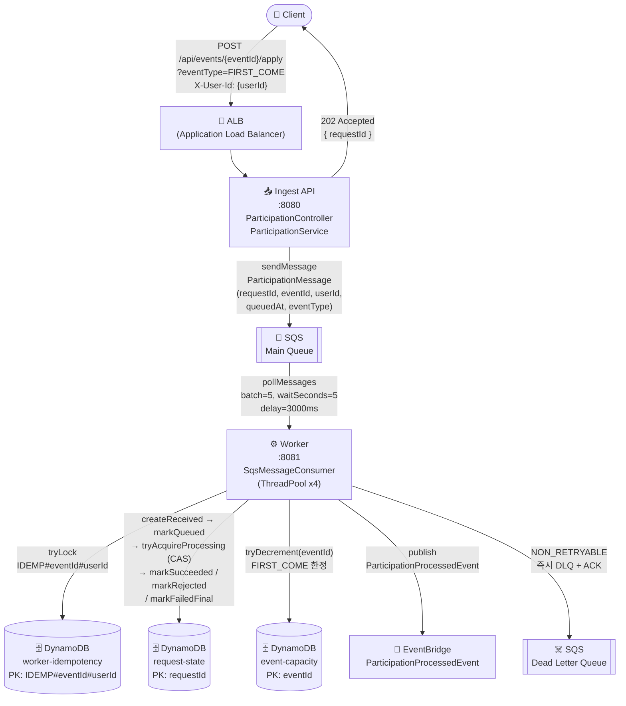
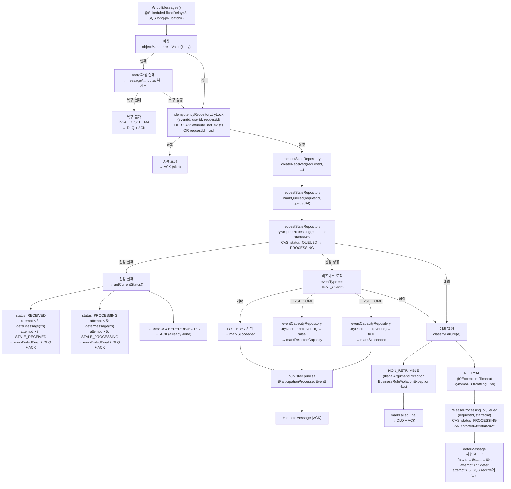
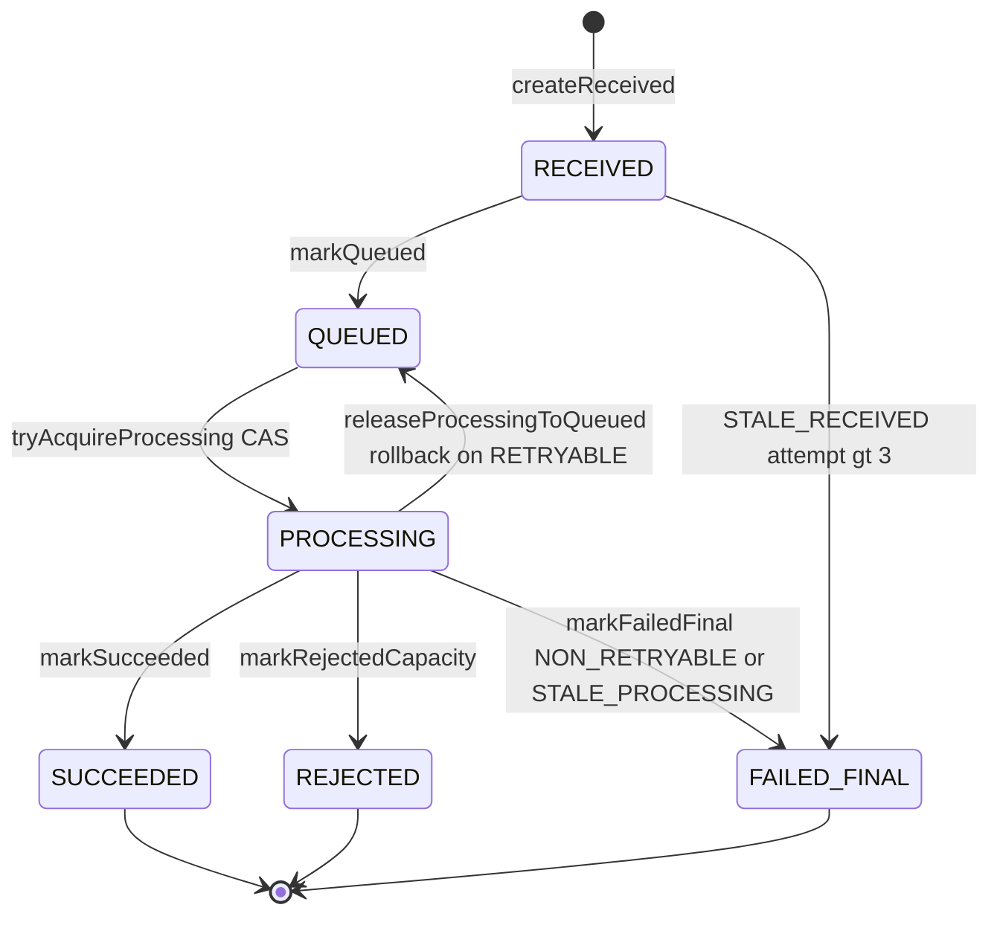
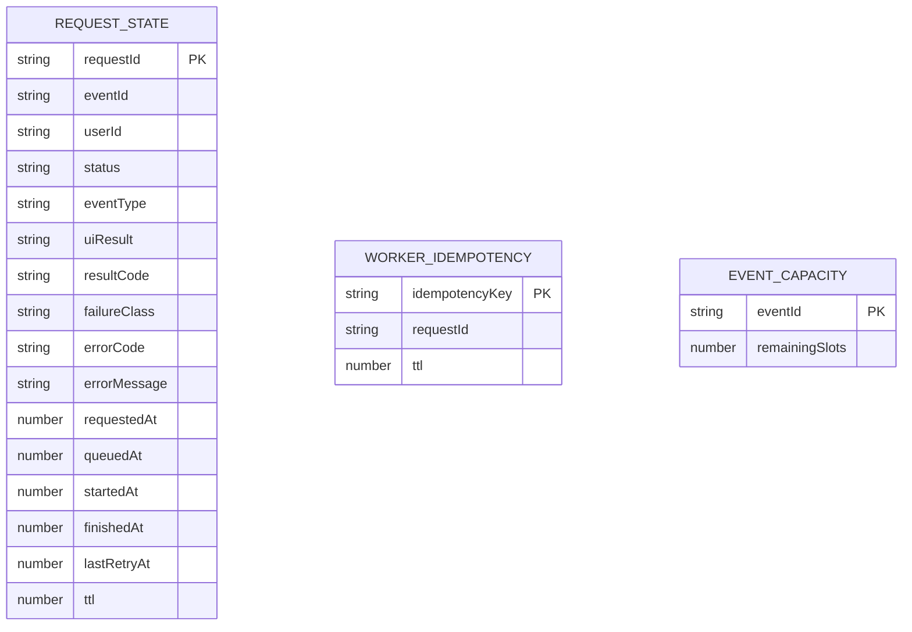
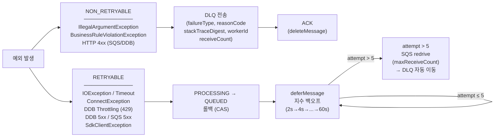

# 비동기 이벤트 플랫폼 — 데이터 흐름 아키텍처

## 1. 전체 아키텍처 흐름

---

## 2. Worker 메시지 처리 상세 흐름

---

## 3. 상태 전이 다이어그램

---

## 4. DynamoDB 테이블 설계

---

## 5. 실패 분류 및 DLQ 전략

---

## 핵심 설계 포인트 요약

| 항목 | 내용 |
|------|------|
| **Ingest 역할** | SQS sendMessage 1회만 → 항상 202 즉시 반환 (수용 계층) |
| **Worker 역할** | 상태 CAS, 비즈니스 로직, 멱등성, DLQ 전략 (처리 계층) |
| **멱등성 보장** | `IDEMP#eventId#userId` 키로 DDB CAS (`attribute_not_exists OR requestId=:rid`) |
| **중복 재전달 대응** | SQS는 at-least-once → idempotency lock으로 최초 1회만 처리 |
| **PROCESSING 고착 방지** | RETRYABLE 실패 시 `releaseProcessingToQueued(requestId, startedAt)` CAS 롤백 |
| **Stale 상태 감지** | RECEIVED > 3회, PROCESSING > 5회 → FAILED_FINAL + DLQ |
| **지수 백오프** | `2 << (attempt-1)` 초, 최대 60초 cap |
| **메트릭** | `duplicate_skip_count`, `non_retryable_dlq_count{reasonCode}`, `retryable_exception_count` |
